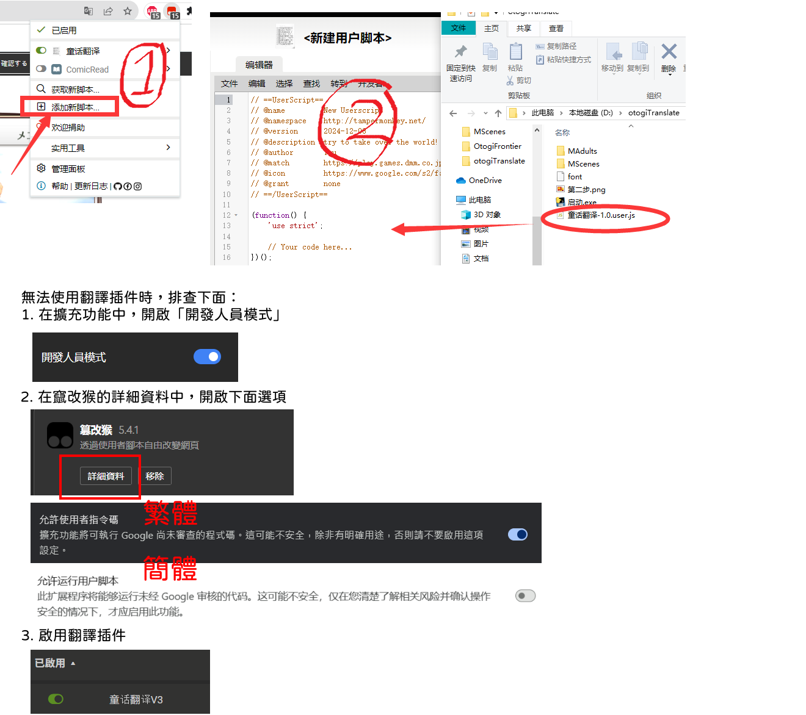
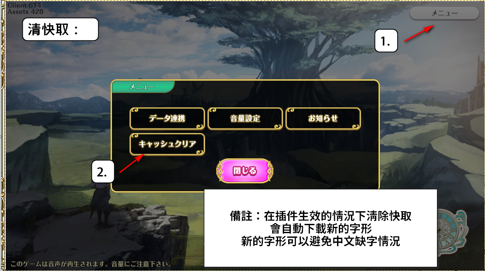

# otogitranslate｜童話前線中文翻譯

《童話前線》（オトギフロンティア / Otogi Frontier）的中文翻譯資料與瀏覽器使用者腳本。腳本在遊戲載入資料時，以本專案的 JSON 字典替換日文文字，並將字型請求導向支援中文字的字型資源。

目前提供繁體、簡體劇情翻譯，以及可選的角色／精靈名稱翻譯。實際翻譯範圍取決於對應的資料檔案與原文是否能匹配。

## 功能

- 替換 `MAdults`、`MScenes`、`MStory` 與 `EventVoice` 相關 API 回傳的文字。
- 透過設定選擇繁體或簡體劇情翻譯。
- 可選擇使用 `trans_dict.json` 翻譯角色與精靈名稱。
- 在部分劇情列表中，確認有對應翻譯檔案後加上 `[翻譯]` 標記。
- 將 `Assets/font` 請求重新導向中文字型資源，減少中文缺字情況。
- Releases頁面提供安卓繁體/簡體APK

## 安裝與使用

一般使用只需安裝使用者腳本，不需要 Python，也不需要在本機啟動伺服器。翻譯資料由腳本從 GitHub 讀取。

1. 在瀏覽器安裝並啟用 Tampermonkey 使用者腳本擴充功能。
2. 開啟 Tampermonkey，選擇「新增腳本」。
3. 開啟本專案的 [童前翻譯插件.js](./童前翻譯插件.js)，複製完整內容，覆蓋編輯器的預設內容後儲存。
4. 確認腳本已啟用，重新載入遊戲。
5. 若字型仍使用舊快取，在遊戲標題畫面選擇「メニュー」→「キャッシュクリア」，再重新載入。或直接清除瀏覽器的全部快取+cookie。

腳本目前的匹配網址為：

```text
https://otogi-rest.otogi-frontier.com/*
```

若遊戲嵌入其他網站，請確認擴充功能允許腳本在上述遊戲框架中執行。

### 安裝圖示

以下為既有操作圖示；圖中的舊腳本名稱請以目前的 `童前翻譯插件.js` 為準。





## 語言與名稱設定

在 Tampermonkey 編輯器中修改腳本開頭的兩個設定，儲存後重新載入遊戲：

```javascript
// 0 = 繁體，1 = 簡體
const SimplifiedChinese = 0

// 0 = 關閉角色名稱翻譯，1 = 開啟
const CharChinese = 0
```

| 設定 | 值 | 行為 |
| --- | --- | --- |
| `SimplifiedChinese` | `0`（預設） | 載入 `<ID>.json` |
| `SimplifiedChinese` | `1` | 載入 `<ID>_gb.json` |
| `CharChinese` | `0`（預設） | 不替換角色／精靈主資料的名稱 |
| `CharChinese` | `1` | 使用 `trans_dict.json` 替換 `MMonsters.gz`、`MSpirits.gz` 的名稱 |

角色／精靈名稱翻譯使用同一份 `trans_dict.json`，不會隨 `SimplifiedChinese` 切換另一份字典。關閉 `CharChinese` 也不會關閉劇情 JSON 中的說話者名稱翻譯。

## 常見問題

| 情況 | 檢查方式 |
| --- | --- |
| 完全沒有翻譯 | 確認腳本已啟用、執行框架符合 `@match`，並檢查瀏覽器主控台是否有 `[拦截]` 訊息 |
| 只有部分內容維持日文 | 確認對應 ID 的 JSON 是否存在，以及正規化後的原文是否有對應 key |
| 切換簡體後沒有翻譯 | 確認同 ID 的 `_gb.json` 存在；目前不會自動回退到繁體檔案 |
| 中文顯示缺字 | 依上方圖示清除遊戲快取，並檢查字型網址的請求是否成功 |
| 角色名稱仍為日文 | 確認 `CharChinese = 1`，重新載入主資料，並確認 `trans_dict.json` 有該名稱 |
| 翻譯資料載入失敗 | 查看主控台的 HTTP 狀態碼與 JSON 解析錯誤，確認可存取 GitHub Raw |

列表中的 `[翻譯]` 標記表示腳本成功載入對應翻譯檔案，不代表該劇情每一句都已翻譯。遊戲 API、資料結構或載入方式變更時，也可能需要調整腳本。
